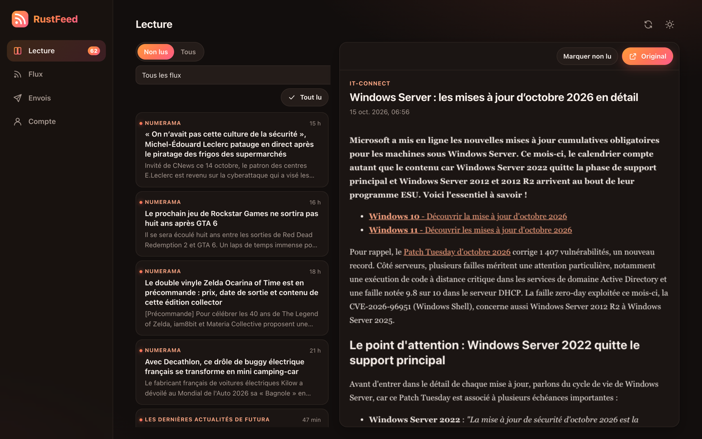
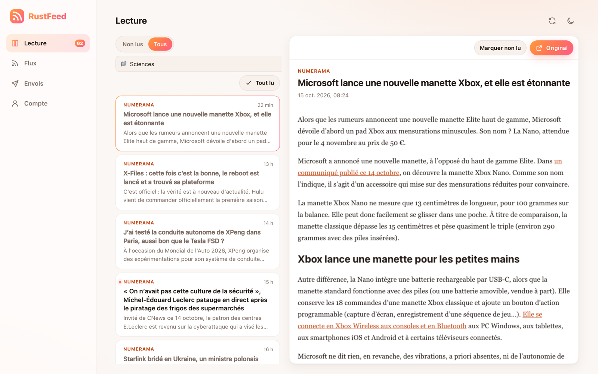
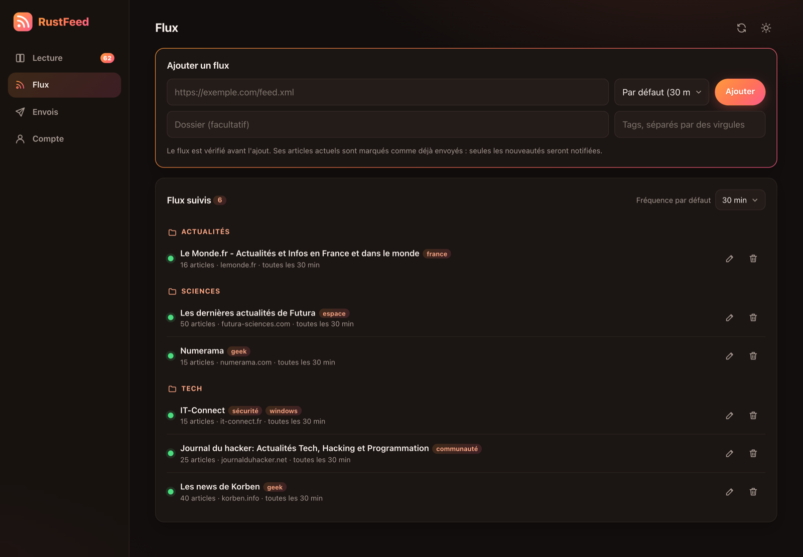
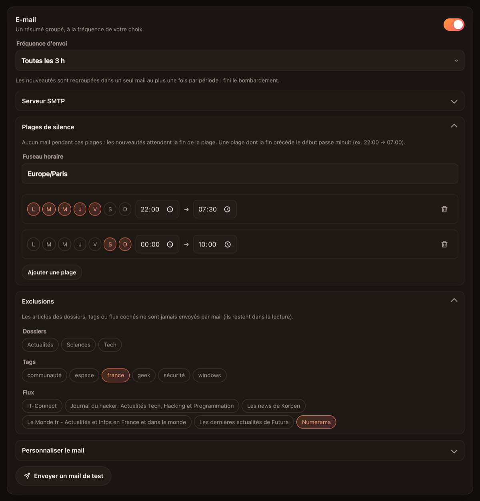
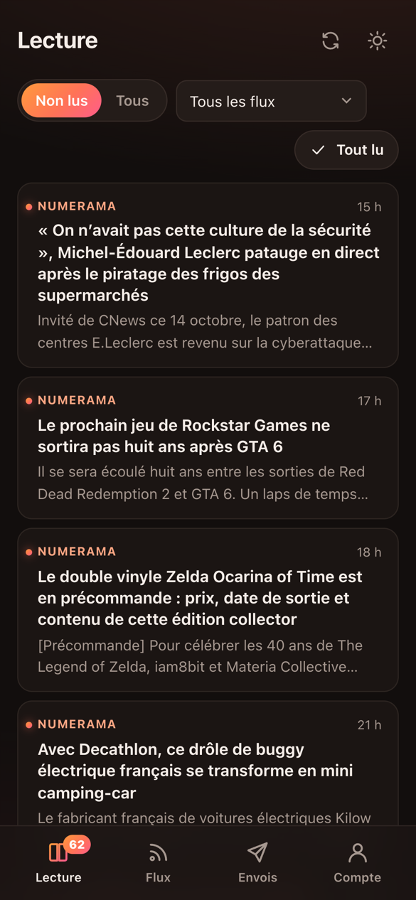
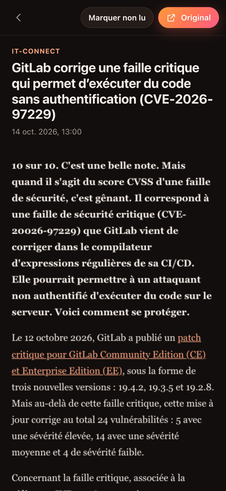

<div align="center">


# RustFeed

**A small, self-hosted RSS reader and relay written in Rust.**
Read your feeds in a fast web app, get new articles on Discord or in a grouped email digest, and let Claude or ChatGPT summarize your day.




</div>

RustFeed checks your feeds on a schedule and sends new articles to a **webhook** (Discord or any JSON endpoint) and/or as **grouped email digests**. Its **web interface** works well on a phone and installs as a PWA: you manage feeds and delivery settings there and read articles in the built-in reader, which shows the **full article** even when the feed only has an excerpt. It is protected by a password and **passkeys**.

It ships as a single binary (the web interface is embedded) and as a multi-arch Docker image. Everything is configured from the browser: there is no file to edit.

---

## Table of contents

- [Features](#features)
- [Screenshots](#screenshots)
- [Quick start](#quick-start)
- [First start: creating your account](#first-start-creating-your-account)
- [Using the web interface](#using-the-web-interface)
- [Folders and tags](#folders-and-tags)
- [Configuration reference](#configuration-reference)
- [Email digests, quiet hours and exclusions](#email-digests-quiet-hours-and-exclusions)
- [Webhook payloads](#webhook-payloads)
- [Running behind a reverse proxy (HTTPS, passkeys, PWA)](#running-behind-a-reverse-proxy-https-passkeys-pwa)
- [MCP server (Claude, ChatGPT)](#mcp-server-claude-chatgpt)
- [Security model](#security-model)
- [Data and persistence](#data-and-persistence)
- [Logs](#logs)
- [Docker images and branches](#docker-images-and-branches)
- [Building from source](#building-from-source)
- [Troubleshooting](#troubleshooting)
- [Contributing](#contributing)

---

## Features

**Reader**
- Built-in web reader with the latest 400 articles, unread/all filters, a filter by folder, tag or feed, and "mark all as read"
- **Full articles**, even when the feed only has an excerpt: the original page is downloaded and its main content extracted (Readability). The **Original** button still opens the site
- Content is rendered in a sandboxed frame where scripts cannot run
- Unread count shown in the navigation (and as an app badge when installed)

**Feeds**
- Any number of RSS feeds, each with its own check frequency (or the global default)
- Organize feeds in **folders** and label them with **tags**
- A feed is fetched and validated before being added. Its current articles are marked as already sent, so you are not flooded with its backlog
- Changes apply immediately, with no restart needed

**Delivery**
- **Webhook**: one message per new article. Discord URLs get a rich embed, and any other URL receives a plain JSON object
- **Email digest**: new articles are grouped into a single email, sent at most once per period (from "after every check" to "once a week"), to one or more recipients
- **Quiet hours**: one or more time ranges, per weekday, during which no email is sent (the night, the weekend...). Articles wait for the end of the range
- **Exclusions**: keep chosen folders, tags or feeds out of the email digest
- **Fully customizable email**: subject, HTML layout and per-article block, with placeholders, a live preview and a "send test email" button

**AI (optional)**
- **MCP server** so Claude or ChatGPT can read your articles: recap of the day, summary of an article. Off by default, HTTPS only

**Interface**
- Dark theme by default with a warm orange-to-pink gradient, plus a light theme
- Responsive: bottom tab bar on phones, sidebar on desktop, a full-screen article view with swipe-back on mobile
- Installable PWA (manifest, icons, offline app shell)

**Security**
- Single account: Argon2id-hashed password plus passkeys (WebAuthn: Face ID, Touch ID, Windows Hello, security keys)
- One-time setup code printed in the logs, so nobody else can claim a fresh instance first
- HttpOnly / SameSite=Strict session cookie, CSRF origin checks
- Per-IP rate limiting, with a stricter limit on login attempts
- Embedded WAF that bans repeat offenders temporarily
- Strict security headers (CSP, frame denial, nosniff, no-referrer, HSTS on HTTPS)

---

## Screenshots

The interface is in French.

| Light theme, filtered by folder | Feeds grouped by folder, with tags |
| :---: | :---: |
|  |  |

| Email: quiet hours and exclusions | On a phone |
| :---: | :---: |
|  |   |

---

## Quick start

### Docker Compose (recommended)

```yaml
# docker-compose.yml
services:
  rustfeed:
    image: ghcr.io/midnights-ra1n/rustfeed:stable
    container_name: rustfeed
    restart: unless-stopped
    ports:
      - "3060:3060"
    volumes:
      - ./data:/app/data
```

```bash
mkdir rustfeed && cd rustfeed
# save the docker-compose.yml above here, then:
docker compose up -d
docker compose logs rustfeed     # shows the one-time setup code
```

Then open **http://localhost:3060** and follow [First start](#first-start-creating-your-account).

There is no configuration file to prepare or edit: everything is set up from the web interface and stored in `./data`. To build the image locally instead of pulling it, use `build: .` in place of `image:` (the repository's `docker-compose.yml` has it commented out).

### Docker run

```bash
docker run -d \
  --name rustfeed \
  --restart unless-stopped \
  -p 3060:3060 \
  -v "$(pwd)/data:/app/data" \
  ghcr.io/midnights-ra1n/rustfeed:stable

docker logs rustfeed             # shows the one-time setup code
```

### Debian / Ubuntu package (.deb)

Each `v*` tag publishes `rustfeed_<version>-1_amd64.deb` and `_arm64.deb` on the [releases page](https://github.com/midnights-ra1n/RustFeed/releases) (Debian 12+, Ubuntu 24.04+).

```bash
sudo apt install ./rustfeed_<version>-1_amd64.deb
journalctl -u rustfeed               # shows the one-time setup code
```

The package installs a `rustfeed` systemd service running as its own `rustfeed` user, with its data in `/var/lib/rustfeed/data` (kept on removal, deleted by `apt purge rustfeed`).

**Updates:** the **Account → Update** card checks the latest GitHub release. On a .deb install, **Install** asks systemd (`rustfeed-update.path`) to run `/usr/lib/rustfeed/update.sh` as root, which downloads the release's .deb for your architecture from GitHub and installs it; the page reloads on the new version (log in again, sessions don't survive a restart). Failures are in `journalctl -u rustfeed-update`. Turn on **Automatic update** in the same card to install new releases on their own (checked every 6 hours, `auto_update = true` in `config.toml`). Docker installs only show the notice: pull the new image.

To release: bump `version` in `Cargo.toml` (it's also what Docker images report), then push a matching tag, e.g. `git tag v0.2.0 && git push origin v0.2.0`.

### Without Docker

See [Building from source](#building-from-source).

---

## First start: creating your account

1. Start RustFeed. The configuration is created with defaults in `data/config.toml`.
2. Look at the logs for this line:
   ```
   No account yet. Open the web interface and use this setup code: 3f9a1c0e7b2d
   ```
3. Open the web interface, enter the setup code, choose a username and a password (10 characters minimum).
4. Go to **Account** and add a passkey to sign in without your password next time. The address you created the account from is saved as the passkey address. Passkeys need HTTPS or `localhost`, see [below](#running-behind-a-reverse-proxy-https-passkeys-pwa).
5. Add feeds in **Feeds**, then set up the webhook and/or email in **Delivery**.

> **Lost your password?** Stop RustFeed, delete `data/auth.json` and start it again. A new setup code is printed and you can create the account again. Feeds and settings are not affected.

---

## Using the web interface

The interface has four tabs. Its text is in French.

| Tab | What it does |
| --- | --- |
| **Lecture** (Reader) | Latest articles from all feeds. Filter by unread/all and by folder, tag or feed, open an article to read it in place, mark it unread, open the original, or mark everything as read. |
| **Flux** (Feeds) | Add a feed with its check frequency, folder and tags, see feeds grouped by folder with each feed's status (reachable, number of articles, last check), edit or delete it, and change the default frequency. |
| **Envois** (Delivery) | Webhook (on/off, URL, test) and email (on/off, digest frequency, SMTP server, sender, recipients, quiet hours and timezone, excluded folders/tags/feeds, template editor with live preview, test email). Click **Save** to apply. |
| **Compte** (Account) | Manage passkeys, set the access settings (public address used by passkeys, reverse-proxy mode), turn the MCP server on and copy its URL, change the password (this signs out every other session), sign out. |

The refresh button at the top checks every feed right away, even if it isn't due. The sun/moon button switches between the dark and light themes. Your choice is remembered per browser.

---

## Folders and tags

Each feed can have **one folder** and **any number of tags** (up to 20), set when you add it or with the pencil button. The **Flux** tab groups feeds by folder, and the reader's filter lists every folder, every tag and every feed.

Use folders for where a feed belongs (*Tech*, *News*, *Science*) and tags for what it covers across folders (*security*, *space*). Both can be used to [exclude articles from the email digest](#email-digests-quiet-hours-and-exclusions) and to filter what an [AI assistant](#mcp-server-claude-chatgpt) reads.

---

## Configuration reference

**Everything is configured from the web interface. There is no file to edit.** Settings are stored in `data/config.toml` and apply immediately, without a restart:

| Setting | Where in the interface | Default |
| --- | --- | --- |
| Feeds, per-feed check frequency, folder and tags | **Flux** | none |
| Default check frequency | **Flux** → *Fréquence par défaut* | 30 min |
| Webhook (on/off, URL) | **Envois** | off |
| Email (on/off, digest frequency, SMTP, sender, recipients, quiet hours, exclusions, templates) | **Envois** | off |
| Public address used by passkeys | **Compte** → *Accès* → *Utiliser l'adresse actuelle* (set automatically when the account is created) | `http://localhost:3060` |
| Reverse-proxy mode (read the client IP from `X-Forwarded-For`) | **Compte** → *Accès* | off |
| MCP server | **Compte** → *Serveur MCP* | off |

The web interface always listens on port `3060` inside the container. To use a different port, change the mapping (`-p 8080:3060`) instead.

**Upgrading from an older version:** if a `config.toml` *file* exists in the working directory and `data/config.toml` doesn't, it is copied to `data/config.toml` once at startup, old format included (`feeds = ["https://..."]`, top-level `webhook`). A `config.toml` *directory*, which Docker creates when a missing file is bind-mounted, is ignored. You can then drop the `config.toml` volume from your compose file or `docker run` command.

> The SMTP password is stored in plain text in `data/config.toml`. Keep the `data/` directory private and prefer an app-specific password.

<details>
<summary>File format, for reference only</summary>

```toml
interval = 1800                   # default check frequency in seconds (min 60)
webhook = "https://discord.com/api/webhooks/<id>/<token>"
webhook_enabled = true
web_port = 3060
public_url = "https://rss.example.com"
behind_proxy = true

[[feeds]]
url = "https://www.clubic.com/feed/rss"

[[feeds]]
url = "https://www.lemonde.fr/rss/une.xml"
interval = 900                    # per-feed override
folder = "Actualités"
tags = ["france", "politique"]

[mail]
enabled = true
smtp_host = "smtp.example.com"
smtp_port = 587
security = "starttls"             # "starttls", "tls" (SMTPS) or "none"
username = "me@example.com"
password = "app-password"
from = "RustFeed <rss@example.com>"
to = ["me@example.com"]
frequency = 3600                  # min seconds between two digests (0 = after every check)
subject = "RustFeed · {{count}} nouvel(s) article(s)"
template = "<h1>{{count}} new articles</h1>{{items}}"
item_template = "<p><a href=\"{{link}}\">{{title}}</a><br>{{description}}</p>"
timezone = "Europe/Paris"         # for quiet hours and {{date}}; empty = server timezone
exclude_folders = ["Actualités"]  # never emailed
exclude_tags = ["sport"]
exclude_feeds = ["https://www.clubic.com/feed/rss"]

[[mail.quiet_hours]]
days = [1, 2, 3, 4, 5]            # 1 = Monday ... 7 = Sunday, the days the range starts on
start = "22:00"
end = "07:00"                     # end before start: runs past midnight

[mcp]
enabled = false
token = ""                        # generated by the interface
```

</details>

---

## Email digests, quiet hours and exclusions

New articles are queued, and once `frequency` seconds have passed since the last email, the whole queue goes out as **one** email, unless the current time is inside a quiet range: then it waits for the end of the range. Articles from excluded folders, tags or feeds are dropped from the queue (an exclusion added later also applies to articles already queued). With `frequency = 0`, an email is sent after every check cycle that found something new. The queue lives in `data/seen.json`, so it survives restarts. If sending fails, the articles stay queued and are retried.

**Recipients.** Enter one or more addresses separated by commas. Every recipient gets the same digest.

**Quiet hours.** Add as many ranges as you need, each with its own days, start and end time, in the timezone set above them (pre-filled with your browser's). A range whose end is before its start runs past midnight, and belongs to the day it starts on: *Mon–Fri 22:00 → 07:30* covers Friday night until Saturday 07:30. Nothing is lost during a quiet range: the digest goes out at the first check after it ends.

**Exclusions.** Tick folders, tags or individual feeds: their articles never reach the digest, but stay in the reader. If you change the URL of an excluded feed, the exclusion follows it.

**Templates.** An email is built from three templates:

| Template | Placeholders |
| --- | --- |
| **Subject** (plain text) | `{{count}}`, `{{date}}` |
| **Email layout** (HTML) | `{{items}}` (all article blocks), `{{count}}`, `{{date}}` |
| **Article block** (HTML, repeated per article) | `{{title}}`, `{{link}}`, `{{description}}`, `{{feed}}`, `{{published}}` |

- Article values are HTML-escaped. Links that are not `http(s)` are replaced with `#`.
- `{{description}}` is the article summary as plain text, cut to 300 characters.
- A plain-text version is added automatically for email clients that don't show HTML.
- Use inline styles: most email clients ignore `<style>` blocks.
- The **Delivery** tab shows a live preview built from your latest articles, has a **Reset templates** button, and can send a test email using the values in the form before you save them.

**Common SMTP settings**

| Provider | Host | Port | Security |
| --- | --- | --- | --- |
| Gmail (app password) | `smtp.gmail.com` | 587 | STARTTLS |
| Outlook / Microsoft 365 | `smtp.office365.com` | 587 | STARTTLS |
| Fastmail | `smtp.fastmail.com` | 465 | TLS |
| Local relay | `localhost` | 25 | None |

---

## Webhook payloads

**Discord** (`https://discord.com/api/webhooks/...`): one embed per article, with the title linking to the article, the summary, the feed name as author, and the publication date in the footer.

**Any other URL** receives a `POST` with this JSON body:

```json
{
  "title": "Article title",
  "link": "https://example.com/article",
  "description": "Plain-text summary (max 300 chars)",
  "feed": "Feed title",
  "published": "Sun, 11 Oct 2026 10:00:00 +0000"
}
```

That works with n8n, Home Assistant, Zapier/Make webhooks, custom scripts, and so on.

---

## Running behind a reverse proxy (HTTPS, passkeys, PWA)

Passkeys and PWA installation require a **secure context**: HTTPS, or `http://localhost` on the machine itself. To use RustFeed from your phone, put it behind a reverse proxy that handles TLS. Then open `https://rss.example.com`, and under **Compte** → **Accès**:

1. click **Utiliser l'adresse actuelle** (use current address) so passkeys are bound to that domain. This is done automatically if you create the account from that address;
2. turn on **Derrière un reverse proxy** (behind a reverse proxy).

Passkeys created on another address stop working when the address changes: add them again. With an `https://` address, cookies get the `Secure` flag and HSTS is sent. The proxy **must forward the original `Host` header**, because RustFeed checks that the `Origin` of every write request matches it (CSRF protection).

**Caddy** (`Caddyfile`), which handles certificates automatically:

```
rss.example.com {
    reverse_proxy localhost:3060
}
```

**nginx**:

```nginx
server {
    listen 443 ssl http2;
    server_name rss.example.com;
    # ssl_certificate / ssl_certificate_key ...

    location / {
        proxy_pass http://127.0.0.1:3060;
        proxy_set_header Host $host;
        proxy_set_header X-Forwarded-For $proxy_add_x_forwarded_for;
        proxy_set_header X-Forwarded-Proto $scheme;
    }
}
```

When a proxy is in front, bind the container to localhost only (`-p 127.0.0.1:3060:3060`) so RustFeed can't be reached around it.

**Installing the app:** open `https://rss.example.com`, then choose **Share → Add to Home Screen** on iOS/iPadOS Safari, or **Install app** on Chrome, Edge or Android.

---

## MCP server (Claude, ChatGPT)

RustFeed can expose an [MCP](https://modelcontextprotocol.io) server so an AI assistant reads your articles. Ask it things like:

- *"Summarize what happened today in my Tech folder."*
- *"What are the security news of the last 48 hours?"*
- *"Summarize this article: https://..."*

 It is **off by default** and only works when the public address is **HTTPS** (see the reverse proxy section above).

1. In **Compte** → **Serveur MCP**, turn it on, then copy the URL (`https://rss.example.com/mcp/<secret>`).
2. Add it as a custom connector: in Claude, **Settings → Connectors → Add custom connector**; in ChatGPT, enable developer mode and add a connector. Claude Code: `claude mcp add --transport http rustfeed <url>`.

Tools offered to the assistant (all read-only):

| Tool | What it returns |
| --- | --- |
| `list_feeds` | Feeds with their title, folder and tags |
| `list_articles` | Recent articles (default: last 24 h), filterable by folder, tag, feed or unread only |
| `get_article` | The full text of an article, extracted from the original page when the feed only has an excerpt |

The URL contains a random 256-bit secret: treat it like a password. **Régénérer l'URL** replaces it (the old URL stops working). A wrong secret counts as a strike for the WAF. Requests sent by a browser from another origin are refused. The assistant can only read articles RustFeed already knows; it can't make RustFeed fetch an arbitrary URL.

---

## Security model

RustFeed is meant for a single owner. Here is what protects the web interface:

| Layer | Details |
| --- | --- |
| Account creation | Only possible with the one-time setup code printed in the logs, while no account exists. |
| Passwords | Argon2id with a random salt. Usernames are compared in constant time, and the hash is always computed so response timing doesn't reveal whether a username exists. |
| Passkeys | WebAuthn via [`webauthn-rs`](https://github.com/kanidm/webauthn-rs), with user verification required. The signature counter is checked to detect cloned authenticators. |
| Sessions | Random 256-bit token in an `HttpOnly; SameSite=Strict` cookie (plus `Secure` on HTTPS), valid 14 days. Sessions are kept in memory, so a restart signs everyone out. Changing the password revokes every other session. |
| CSRF | Every non-GET request must be JSON and come from the same origin (`Origin` must match `Host`, or `Sec-Fetch-Site` must be same-origin). |
| Rate limiting | 240 requests per minute per IP, plus 10 authentication attempts per minute per IP. Excess requests get `429` with `Retry-After`. |
| WAF | Inspects the URL and headers for path traversal, SQL injection, XSS, template and command injection, Log4Shell-style headers, scanner paths (`/.env`, `/.git`, `/wp-*`, `*.php`...) and known attack tools (sqlmap, nikto, nuclei...). Matches get `403`. |
| Bans | 5 strikes (WAF blocks, failed logins, wrong setup code, failed passkey logins) ban the IP for 15 minutes. |
| Request size | Bodies are limited to 256 KB. |
| Headers | Strict CSP (`script-src 'self'`, `frame-ancestors 'none'`...), `X-Frame-Options: DENY`, `nosniff`, `Referrer-Policy: no-referrer`, a restrictive `Permissions-Policy`, COOP, and HSTS on HTTPS. |
| Untrusted content | Feed HTML and extracted articles are shown in a sandboxed `iframe` with no scripts and no same-origin access. Email templates escape every article value. |
| MCP | Off by default, HTTPS only, secret URL token compared in constant time, read-only tools. |

What it does **not** do: there are no multiple users or roles, sessions don't survive restarts, and the SMTP password is stored in plain text in `data/config.toml`. Feed URLs can point anywhere, including your local network, but only you can add them. To show full articles, RustFeed also downloads the article links found in your feeds: a feed you don't trust could make it request an address of your local network.

---

## Data and persistence

| Path | Contents |
| --- | --- |
| `data/config.toml` | Configuration (feeds with folders and tags, webhook, mail settings and SMTP password, access settings, MCP secret). Managed by the web interface. |
| `data/seen.json` | Links already sent, the reader's articles (latest 400), read state, and the pending email queue. The sent history is reset every 30 days without re-sending anything. |
| `data/auth.json` | Account: username, password hash, passkeys. Delete it to reset the account. |

In Docker, mount `./data` (see [Quick start](#quick-start)): it is the only volume, and without it everything is lost when the container is recreated. Back it up to back up everything.

---

## Logs

RustFeed logs to stdout/stderr (`docker logs rustfeed`, `docker compose logs`, journald, and so on):

- startup: listening address, setup code (when there is no account), passkeys disabled because the public address is unusable
- new articles and the number of articles in each digest email sent
- fetch errors per feed, webhook and SMTP errors (other feeds keep running)
- failed logins, WAF blocks and IP bans
- the 30-day history reset

---

## Docker images and branches

| Branch | Role |
| --- | --- |
| `dev` | Integration branch for ongoing work. |
| `stable` | Release branch. Every push builds and publishes the Docker image. |

The [GitHub Actions workflow](.github/workflows/docker-publish.yml) runs on every push to `stable` (or manually from the **Actions** tab). It builds each architecture on a native GitHub runner, so there is no slow QEMU emulation, and publishes one multi-arch image to GHCR:

| Platform | Base image |
| --- | --- |
| `linux/amd64` | Debian bookworm-slim |
| `linux/arm64` | Ubuntu 24.04 |

Tags: `ghcr.io/midnights-ra1n/rustfeed:stable`, `:latest` and `:sha-<short commit>`. `docker pull` picks the right architecture automatically (Raspberry Pi 4/5 with a 64-bit OS, Apple Silicon, Ampere/Graviton servers...).

> Packages pushed with `GITHUB_TOKEN` are **private by default**. After the first run, open the package settings on GitHub and make it public if you want to pull it without logging in.

---

## Building from source

Requirements: a recent stable [Rust toolchain](https://rustup.rs/), a C compiler, `make` and `perl`. OpenSSL is compiled from source and linked statically, because the WebAuthn library needs it.

```bash
git clone https://github.com/midnights-ra1n/RustFeed.git
cd RustFeed
cargo build --release
./target/release/RustFeed
```

RustFeed keeps everything in `data/` under its working directory. The interface is then at http://localhost:3060.

Run the tests (config parsing, quiet hours, exclusions, WAF rules, rate limiting, CSRF check, password hashing, email rendering, MCP negotiation):

```bash
cargo test
```

Build the Docker image locally (for one architecture, or both with buildx):

```bash
docker build -t rustfeed .
docker buildx build --platform linux/amd64,linux/arm64 -t rustfeed .
```

**Project layout**

```
src/
  main.rs      polling loop, scheduling, webhook dispatch, digest sending
  config.rs    data/config.toml loading/saving, legacy migration
  rss.rs       feed download and parsing, full article extraction
  mcp.rs       MCP server for LLM clients
  state.rs     sent history, reader articles, read state, mail queue
  discord.rs   webhook sender (Discord embed or generic JSON)
  mail.rs      email templates and SMTP
  auth.rs      account, passwords, sessions, passkeys
  security.rs  WAF, rate limiting, CSRF check, security headers
  web.rs       HTTP routes and JSON API
web/           HTML/CSS/JS, PWA manifest, service worker, icons (embedded at compile time)
```

---

## Troubleshooting

**"Is a directory" error with an older version.** Older versions read `./config.toml`, and Docker creates a directory when a missing file is bind-mounted. Current versions only use `data/`: update the image, remove the `config.toml` volume and the `config.toml` directory on the host.

**I can't find the setup code.** It is only printed while no account exists: `docker logs rustfeed | grep "setup code"`. A new one is generated on every start until the account is created.

**There's no "add passkey" form, or it says passkeys are disabled.** Passkeys work on one address only: open **Compte** → **Accès** and click **Utiliser l'adresse actuelle**. The address must be a domain name over HTTPS, or `localhost`. IP addresses (`http://192.168.1.10:3060`) cannot use passkeys.

**"Origine refusée" (origin refused) on every action behind a proxy.** The proxy isn't forwarding the `Host` header. Add `proxy_set_header Host $host;` (nginx).

**"Adresse temporairement bloquée" (address temporarily blocked).** Your IP has 5 strikes (for example, wrong passwords) and is banned for 15 minutes. Behind a proxy without reverse-proxy mode, every client shares the proxy's IP: turn it on in **Compte** → **Accès**.

**I added a feed and nothing was sent.** This is expected: the articles already in a new feed are marked as sent. Only articles published afterwards are delivered, and they still show up in the reader.

**The reader still shows only an excerpt.** RustFeed downloads the original page to extract the article. Some sites block servers or need JavaScript to show their content; the feed's excerpt is then shown instead. The **Original** button always opens the site.

**I can't turn on the MCP server.** It needs an `https://` public address: put RustFeed behind a reverse proxy, open it through that address and click **Utiliser l'adresse actuelle** in **Compte** → **Accès**.

**No email during the night, or at the wrong time.** Check the quiet ranges and the timezone in **Envois** → **Plages de silence**. Without a timezone, the server's is used, which is UTC in Docker.

**The test email fails.** The error comes from the SMTP server. Check the host, the port and security pair (587 with STARTTLS, 465 with TLS), and use an app password for Gmail and Outlook.

---

## Contributing

See [CONTRIBUTION.md](CONTRIBUTION.md). Issues and pull requests are welcome. Please target the `dev` branch.
